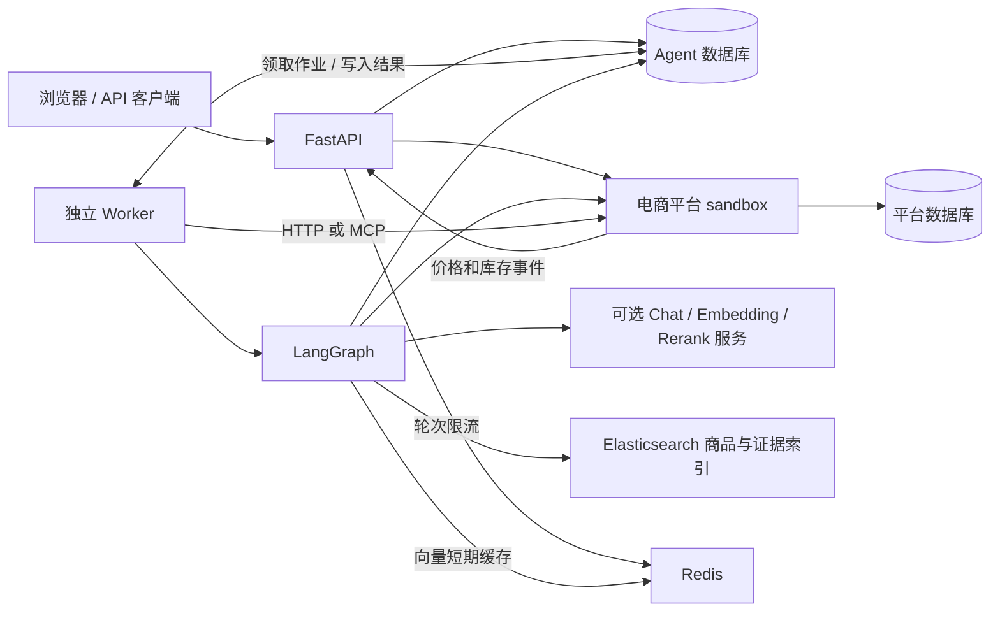
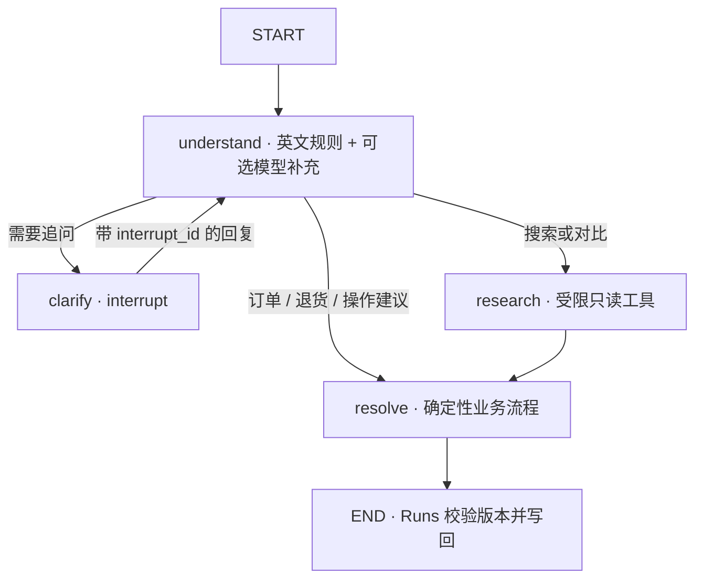
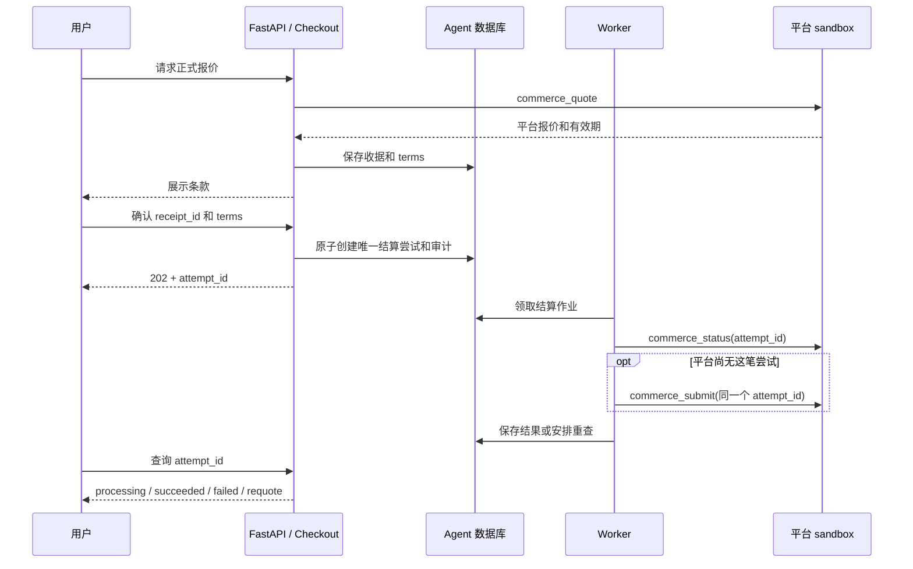

# Shopping Agent V2 项目详解

本文以源码提交 `851f639` 为基准。面向准备运行、阅读或扩展项目的开发者。英文启动说明见 [README](README.md)。

- [1. 设计与运行方式](#1-设计与运行方式)
- [2. 数据模型与存储](#2-数据模型与存储)
- [3. 一轮购物请求怎么执行](#3-一轮购物请求怎么执行)
- [4. 商品检索、组合与证据](#4-商品检索组合与证据)
- [5. HTTP 与 MCP 平台接入](#5-http-与-mcp-平台接入)
- [6. 购物车、结算、订单与退货](#6-购物车结算订单与退货)
- [7. 价格提醒和自动采购](#7-价格提醒和自动采购)
- [8. Amazon Reviews’23 与评估](#8-amazon-reviews23-与评估)
- [9. API 速查](#9-api-速查)
- [10. 逐文件代码导读](#10-逐文件代码导读)
- [11. 本地复现与测试](#11-本地复现与测试)
- [12. 当前实现边界与排查](#12-当前实现边界与排查)

## 1. 设计与运行方式

这是一个以 Python 后端为主的英文 Shopping Agent。用户可以找商品、比较或修改组合、加购物车、核价下单、查看分包物流、申请退货，以及设置降价、到货与定期任务。浏览器界面通过同一套 FastAPI 接口演示核心操作。

系统的关键边界是**模型理解语言，后端校验规则，平台确认交易事实**。LangGraph 整理购物目标并调度只读研究工具。目录检索提供候选商品和评论。只有平台的报价、库存和订单接口能决定当前成交条件。购买和退货要求用户经独立 API 确认，自动购买则使用用户提前授权的规则。



| 组件 | 当前职责 |
|---|---|
| Python 3.12、FastAPI、Pydantic | HTTP API、请求约束、账户识别、OpenAPI 文档和 SSE 进度流 |
| LangGraph | 按任务状态运行意图解析、澄清、工具研究和结果生成，依靠 checkpointer 保存执行位置 |
| PostgreSQL / SQLite、SQLAlchemy Core | 任务、版本快照、作业、授权和交易记录。Compose 用 PostgreSQL，本机模式用 SQLite 文件 |
| Elasticsearch | 英文 BM25 关键词检索、HNSW 向量召回、可选 CLIP 图片召回。Python 侧融合各路结果 |
| Redis | 配置后用于账户级轮次限流和外部 embedding 的短期缓存 |
| 平台 sandbox | 实现可控的账户、库存、报价、订单、模拟支付、物流、退货和商品事件。对外有 HTTP 和 MCP 两种入口 |
| Worker | 独立循环处理自然语言轮次、结算对账、自动化规则和后台加购 |

### 本机模式和 Compose 模式

| 项目 | 本机默认 | Docker Compose |
|---|---|---|
| 启动入口 | `python -m shopping_agent api` | `docker compose up --build -d` |
| Agent 状态 | `.data/agent.db`，检查点在同目录的 `agent.db.checkpoints` | PostgreSQL 的 `agent` 数据库，LangGraph 有独立的 checkpoint 表 |
| 平台状态 | `.data/platform.db`，服务进程内直接调用 `MockPlatform` | 同一 PostgreSQL 实例的独立 `platform` 数据库，Agent 通过 MCP 访问 |
| 检索 | 读取 SQLite 目录，在 Python 内实现 BM25 和向量相似度 | Elasticsearch 8.19.0，启动时一次性 `indexer` 生成目录和证据索引 |
| Worker | API 进程内的后台线程，由 `EMBEDDED_WORKER` 控制 | 单独容器消费数据库里的作业 |
| 模型 | 默认可用英文规则与本地演示向量，可接外部服务 | 同样可选。Compose 读取模型相关环境变量 |
| 访问 | Agent `127.0.0.1:8000` | Agent `127.0.0.1:8000`，平台 `127.0.0.1:8001`。数据库、Redis 和索引在容器私网 |

启动代码在 [`__main__.py`](shopping_agent/__main__.py)，配置集中在 [`core.py`](shopping_agent/core.py) 的 `Settings`。CLI 先读取 `.env`，再从对应的大写环境变量构建配置。`Runtime` 初始化数据库、演示数据、平台适配器、模型客户端、检索、结算和自动化服务。`api` 与 `worker` 可以同时运行，各自用持久化存储交换任务。`worker`、`reindex` 和 `import-reviews23` 都由同一 CLI 分发。

## 2. 数据模型与存储

### 购物业务对象

| 对象 | 含义与示例 |
|---|---|
| `Product` | 商品组或系列。`Aurora Air 14` 下有多个实物规格 |
| `SKU` | 具体规格。`air-16` 与 `air-8` 是两个 SKU，即使标题同属一个系列，视频输出能力也可能不同 |
| `Offer` | 可买的销售条目。`air-16-official` 和 `air-16-partner` 是同一 SKU 的不同报价，各有卖家、库存、单价、送达条件 |
| `Line` | 买卖双方明确指向的 `offer_id` 与数量。数量为 1–20，一次请求最多 20 条，重复 Offer 被拒绝 |
| `Goal` | 当前购物任务的结构化约束，例如 `categories`、`budget`、`deadline`、`hz`、`ports`、`min_ram`、`max_weights` 和 `address_id` |
| `Plan` | 一组可买条目、平台核价快照和兼容性证据。`plan_id` 从排序后的 Offer ID 生成，选择时还要带上任务版本 |
| `Quote` | 平台的报价快照。绑定账户、地址、Offer、SKU、数量、价格组成、送达时间和有效期 |
| `Receipt` / Checkout attempt | Agent 保存待确认条款的收据，用户确认后产生可异步查询的结算尝试 |
| `Order` / Parcel | 平台订单与分包记录。sandbox 按卖家生成包裹，每个包裹独立推进交付状态 |
| `Review evidence` | 按商品组或明确 SKU 关联的评论证据。来源和证据 ID 随结果返回 |

金额统一用**整数美元分**，例如 `100000` 代表 $1,000。服务内部时间多为 Unix 秒，面向用户的摘要使用 ISO 时间。英文日期解析使用请求带来的 IANA 时区，默认 `America/New_York`。Reviews’23 的原始评论时间戳保留原始整数，属于不同的输入字段。

### 实际数据库结构

[`storage.py`](shopping_agent/storage.py) 用一张 `shopping_records` 表承载不同类型的记录。主键是 `(bucket, key)`，`owner` 存账户或关联实体；业务 JSON 放在 `value`，队列查找用 `state` 和 `due`。PostgreSQL 的 `value` 使用 JSONB，SQLite 使用 JSON。常用查询有 `(bucket, owner)` 和 `(bucket, state, due)` 索引。`bucket` 是逻辑分组，每一行仍在同一物理表里。

| 存储域 | 逻辑分组 | 内容 |
|---|---|---|
| Agent 任务 | `tasks`、`task_views`、`runs`、`preferences` | 当前目标和方案、历史版本、轮次状态与 SSE 事件、账户偏好 |
| Agent 目录 | `products`、`catalog`、`evidence`、`vectors` | 商品组、搜索文档、评论证据、按内容和模型复用的文档向量 |
| Agent 交易 | `quotes`、`checkouts`、`return_quotes`、`return_results` | 确认收据、待对账及已完成的购买、退货确认和结果 |
| Agent 自动化 | `automations`、`watch_offers`、`automation_runs`、`received_offer_events`、`notices` | 授权条件、Offer 反查索引、周期执行记录、事件去重、站内通知 |
| Agent 审计 | `audit` | 轮次完成、确认下单、退货以及自动化授权和执行记录 |
| 平台账户和目录 | `accounts`、`offers`、`price_history`、`offer_events`、`controls` | 演示账号、销售条目、历史观测、待投递事件、模拟支付故障开关 |
| 平台交易 | `carts`、`cart_ops`、`platform_quotes`、`platform_attempts`、`platform_quote_use`、`orders`、`payments`、`returns`、`return_ops` | 购物车版本、幂等键、正式平台报价和交易结果、支付流水及退货申请 |

`Store.transaction()` 统一提交与回滚。SQLite 写事务使用 `BEGIN IMMEDIATE`，并开启 WAL 和等待锁超时。PostgreSQL 在需要排他读的地方使用行锁。Worker 领取作业时使用 `FOR UPDATE SKIP LOCKED`，避免两个 Worker 同时领取同一当前作业。`put(..., once=True)` 使用冲突时不覆盖的插入，适合事件去重、请求留痕和初始种子。

LangGraph checkpoint 保存**执行位置和图状态**。`task_views` 保存**用户见到的业务版本**。例如，图恢复后可以继续问答，随后后端仍要验证任务的版本再提交结果；用户点击历史卡片时，版本快照决定要查的 Offer，平台会重新核价。

## 3. 一轮购物请求怎么执行

演示使用这句英文请求。

> Find a lightweight laptop and a dock that can drive a 4K 60 Hz monitor, under $1,000 total.

1. 客户端先创建任务，然后提交 `Turn`。`POST /v1/tasks/{task_id}/turns` 将账户、当前目标、方案快照、原文和时区保存进 `runs`，立即返回 `202` 和运行 ID。传 `request_id` 可以让同一个请求重发时返回同一运行记录，重复 ID 的请求内容不同会冲突。
2. `Worker.tick("runs")` 领取到期记录，写入随机租约和 `running` 进度。租约有效期为 420 秒。`Runs.step()` 用运行 ID 作为 LangGraph `thread_id`，查看已有检查点，选择启动、继续、中断恢复或读取完成结果。写回前再次检查租约。
3. `understand()` 调用 `detect()` 识别英文意图、品类、预算、重量、内存、4K 刷新率、端口、已有方案编号等。显式日期和部分英文周几表达由本地规则解析。这里的显示器是连接目标，购物槽位是笔记本与扩展坞。`lightweight` 影响排序，$1,000 是整套上限。
4. 配置 Chat 模型时，`understand()` 先完成规则解析，再要求模型返回符合 `Patch` 的 JSON，用其结果补充结构字段。解析失败时保留规则结果。`route()` 根据缺失信息和意图选择澄清、研究或直接处理。
5. 研究节点可运行只读 Function Calling，随后 `resolve()` 进行真正的组合检索、平台核价和证据读取。查询订单会直接向平台查当前账户的订单；检测到加购、结算或提醒意图时，可以生成 `suggested_action`，由客户端再调用对应接口。
6. `Runs._commit()` 检查任务是否仍是运行开始时的 `base_version`。匹配时递增任务版本，保存当前任务、历史快照、运行结果和审计。若另一个客户端已更新版本，则本轮以 `task_conflict` 结束，避免迟到的结果覆盖新状态。
7. 客户端可以轮询 `GET /v1/runs/{run_id}`，也可以订阅 SSE。`Last-Event-ID` 用于从已收到的序号之后继续读。每个运行保留最近 40 条状态事件，终态事件可携带结果、追问或错误。当前 demo 使用按运行 ID 轮询。



**澄清例子。** 用户只说 “Find a dock that can drive a 4K 60 Hz monitor.”，系统缺少主机的视频协议，因此 `clarify()` 用 `interrupt()` 暂停。API 返回 `needs_input` 和 `interrupt.id`。回复 “My laptop supports DisplayPort 1.4 Alt Mode.” 后，Worker 用 `Command(resume=...)` 恢复原轮次，重新理解输入。澄清中的笔记本提供主机规格，原始购买目标仍只有扩展坞。

**多轮修改例子。** “Option 2, keep the laptop and replace the dock with a lighter dock.” 会在 `plan_version` 对应的历史结果中选第二套，固定原笔记本的 SKU 和 Offer，并排除原扩展坞。旧扩展坞有已知重量时，`lighter` 会临时要求新扩展坞更轻。原预算仍进入平台整套核价。该重量比较是本轮搜索约束，持久化的任务目标遵循 `understand()` 产出的 `goal`。

### 模型能调用的工具

`research()` 最多请求两轮模型工具调用，每轮最多处理三个工具。`search_products` 只能在任务允许的品类范围检索，回收每个品类最多两个不同的查询改写。`get_product_evidence` 只能查本次工具研究中已经见过的 `product_id`。参数由 `Search` 或 `Evidence` 校验，每次工具结果的传回文本也有长度限制。工具轨迹只记录工具名和是否成功。下单、购物车写入与自动化写入由服务端业务 API 控制，模型直接提出类似 `commerce_submit` 的工具调用会被拒绝。

## 4. 商品检索、组合与证据

### 4.1 Elasticsearch 如何召回和融合

[`catalog.py`](shopping_agent/catalog.py) 把商品标题、品牌、具体规格名称、外部产品 ID、描述、类目、规格和属性组合成可搜索文本。评论证据用其正文。搜索目录会施加 `active=true`、`market=US` 和可选品类过滤，证据检索按 `product_id` 限定。每次混合搜索最多使用三个不同查询，查询改写先在各路内部合并。

| 路径 | 实际行为 |
|---|---|
| 关键词 | Elasticsearch 在 `title^4`、`brand^2`、`variant^2`、`text` 上做 `multi_match`，用英文分析器，并对 `search_terms` 的命中加权。`tokens()` 保留形如 `USB-C`、`4K@60Hz` 的复合 token，并归一化少量英文同义词 |
| 文本向量 | `Models.embeddings()` 生成查询向量，通过 `dense_vector` 的 `knn` 召回。索引显式配置 `hnsw` 与余弦相似度，`num_candidates` 按候选目标的四倍配置、最多 1,000 |
| 图片向量 | 装有可选依赖、配置 `CLIP_MODEL`、重建时提供本地商品图片，且请求包含图片或外观词时生成 CLIP 查询向量。在规划器中当前仅用于单品类搜索 |
| 融合与精排 | 先融合相同通道的改写结果，再在关键词、文本向量和可用的图片通道之间做 RRF。若配置 `RERANK_URL`，将融合候选交给外部接口，验证排序结果后应用；否则沿用融合排名 |

RRF 按文档在每路的排名累加 `1 / (60 + rank)`，排名从 1 开始，每个结果列表按文档 ID 去重。搜索服务会回读 Agent 数据库中的文档，并重新验证过滤条件。`trace.search` 给出 `keyword`、`semantic`、`fused`，使用图像通道时还有 `image`。在 Elasticsearch 模式，语义路失败时可保留关键词排名。关键词服务不可用会报告 `search_unavailable`。本机模式直接扫描小目录，在 Python 中算 BM25 和向量相似度。

### 4.2 模型和索引之间的数据流

[`models.py`](shopping_agent/models.py) 对接兼容的 `/chat/completions`、`/embeddings` 与 `/rerank`。Chat 可以携带工具 schema，也可以请求 JSON 对象。外部 embeddings 返回后核对输入顺序、维度和有限数值。外部精排要求返回候选索引与相关性分数，候选集不完整或失败时沿用融合顺序。

- 没有设置 `EMBEDDING_MODEL` 时，使用 128 维归一化哈希向量，适合本地演示与回归。配置语义 embedding 后，需要以同一模型重建索引。
- Agent 数据库持久缓存文档向量，以模型名、端点和文档文本生成键。配置 Redis 后，外部 embedding 还会有 600 秒的短期缓存。
- `Catalog.rebuild()` 分批读目录与证据，创建带随机后缀的新索引并通过 bulk 写入。两个索引都写完、刷新后，一次提交别名切换。别名分别是 `{INDEX}-catalog` 和 `{INDEX}-evidence`。旧物理索引保留。
- CLIP 路径需要 `.[vision]` 和商品图片文件。`--images` 指向本地目录，文件名使用目录文档 ID，格式可为 JPEG、PNG、WebP。重建时调用 CLIP 图像编码器。输入有参考图片时也用图像编码器，仅有文本时用其文本编码器。Reviews’23 的图片 URL 作为来源数据保存，图片建索引读的是指定目录里的文件。

### 4.3 组合、兼容性与权威报价

[`planner.py`](shopping_agent/planner.py) 实际交付的是在当前业务约束下可买的**方案**，而不是只按文本相关性列商品。

1. `_pools()` 为各购买槽位并行取候选。固定的 SKU 会直接从目录读取，候选不足时整轮从每槽位 10 扩至 22。
2. `_eligible()` 校验 SKU、最小内存和明确重量上限。只有商品组的目录数据仍能用于研究、展示和评论证据。
3. `find()` 批量向平台获取候选 SKU 的 Offer，处理库存、USD 币种及自动化卖家授权限制。每个 SKU 按价格、送达时效和 ID 留最多三个 Offer。历史方案固定项会继续绑定原 Offer。
4. `compatibility()` 从具体笔记本 SKU 或澄清取得主机视频协议和级别，核对扩展坞输入要求与目标接口上的 4K 刷新率。若购买显示器，它的接口也进入校验。成功结果包含带来源和版本的规格证据。关键规格缺失时无法建立可买的已认证组合。
5. `_pairs()` 在槽位内组合候选，按粗略预算命中、重量或相关性及估算价取前 22 组。估算价用来排序。`_price()` 再并行获取平台报价，校验实际总价、最晚到货时间、Offer 和 SKU 绑定，并按 SKU 组合去重，最多展示三套。

例如，`air-16` 和 `air-8` 都叫 Aurora Air 14。演示目录中的 `air-16` 声明 `dp_alt: 14`，可与要求该级别且支持 4K 60Hz 的扩展坞配对；`air-8` 的视频能力为空。`link-lite` 可输出 4K 30Hz，即使标价低，也不满足 60Hz 约束。

### 4.4 RAG 证据怎么进入回答

可买方案的`规格、价格和到货`来自规则和平台结果。`describe()` 用这些数据生成英文摘要。对入选商品，`Catalog.evidence()` 在相应商品组的评论中检索证据；若当前只有研究条目，也可以返回这些条目的评论。

可用模型会挑选最多三个评论原文摘录。`highlights()` 检查证据 ID 存在、摘录长度合法且原文包含该段逐字文本。摘录保留证据来源，反映评论者的体验。模型请求失败时使用检索到的短摘录。规格结论和商品评论在结果中分字段呈现。

## 5. HTTP 与 MCP 平台接入

Agent 业务通过 `platform.call(tool_name, arguments)` 访问平台。[`platform.py`](shopping_agent/platform.py) 中的 `TOOL_INPUTS` 将工具名映射到 Pydantic 请求类型。默认使用进程内的 `MockPlatform`。配置 `PLATFORM_URL` 后，由 `RemotePlatform` 按 `PLATFORM_TRANSPORT` 选择 HTTP 或 MCP。

| 方式 | 调用形态 |
|---|---|
| 进程内 | `MockPlatform.call()` 校验请求，再派发到同名业务方法 |
| HTTP | `POST {PLATFORM_URL}/tools/{name}`，请求正文直接是业务参数 |
| MCP | 连接 `PLATFORM_URL` 指向的 Streamable HTTP `/mcp`，初始化 MCP session，再执行 `call_tool(name, {"payload": args})` |

远程调用携带 `Authorization: Bearer <PLATFORM_TOKEN>`。平台工具返回含 `ok` 的统一 envelope。成功结果在 `value`，业务错误在 `error`，带 `code`、`message` 和 `status`。`RemotePlatform.call()` 解包结果。传输失败、解析失败或意外 envelope 会变成服务错误，交给上层处理。MCP 资源由 `FastMCP` 的会话管理器初始化，服务注册每个工具的输入模型与结构化输出。

| 平台工具 | 当前业务语义 |
|---|---|
| `commerce_account` | 获取账户地址和已保存付款方式引用 |
| `commerce_offers` | 批量通过 SKU 查询销售条目和当前库存 |
| `commerce_history` | 查指定 Offer 的价格观测历史 |
| `commerce_quote` | 按账户、地址和 Offer 数量重新核价 |
| `commerce_cart` · `commerce_cart_write` | 读取购物车或用版本和幂等操作 ID 加删行 |
| `commerce_submit` · `commerce_status` | 提交已确认的购买尝试或按稳定 ID 查状态 |
| `commerce_orders` · `commerce_order` | 读取账户订单列表、单笔订单与分包 |
| `commerce_return_preview` · `commerce_return_request` | 计算退货资格与预计退款，提交已确认申请 |

**两种“工具调用”的职责不同。** LangGraph 中的模型 Function Calling 只选取商品检索与证据工具。MCP 是可信业务服务之间的传输层，能承载购物车和下单调用。结算 Worker 按已确认条款调用 `commerce_submit`。

## 6. 购物车、结算、订单与退货

### 6.1 购物车写入

购物车读回 `version` 和 `lines`。`POST /v1/cart/changes` 要求提供 `operation_id`、`expected_version`、`mode`，以及历史方案选择或明确的 Offer 行。API 对历史方案先校验账户和版本，再提取实际 Offer 行。

`MockPlatform.cart_write()` 在事务中锁定账户，先按账户和 `operation_id` 查结果。相同操作重发会回放旧结果，重用 ID 但改变条目或操作模式会冲突。第一次写入校验 `expected_version`，受库存、每行数量和购物车行数限制。成功时版本加一。加购用于保留条目，正式下单以结算时的库存检查为准。

### 6.2 先确认报价，再异步执行

自然语言选择、“研究结果中的估价”和“用户确认的正式报价”分别有自己的调用阶段。`POST /v1/quotes` 可以选择历史方案、指定购物车版本，或传明确 Offer 行。`Planner.quote()` 使用平台工具取报价，核对账户、地址、Offer、数量、必要时核对 SKU。`Quote.check_totals()` 还验证小计、运费、税费、折扣、总价与最晚行到货时间。

`Checkout.prepare()` 会检查有效期、整单预算与截止时间，再保存新的 Agent 收据。收据含 Agent 的 `id`、平台 `quote.id`、`constraints` 与 `terms`。`terms` 是由规范化报价 JSON 计算的 SHA-256 指纹。sandbox 报价有效期为 300 秒，计税和优惠字段目前用零值演示。



`Checkout.confirm()` 对账户内的收据加锁，验证 `terms`、期限和原任务约束。结算尝试 ID 由账户与收据 ID 派生。客户端双击或重发仍拿到同一个尝试。Worker 先向平台查询原 ID，平台尚未登记才提交。平台用独立的尝试记录和报价使用记录防止重复执行。

| 结果 | 处理 |
|---|---|
| `processing` | 平台仍在处理，或暂时无法验证结果。保留尝试，指数退避后用同一 ID 重查 |
| `succeeded` | 验证有订单 ID 且实付与原条款相符，记录终态和审计 |
| `failed` | 记录缺货、拒付等确定结果。客户端可以按业务提示重新研究或报价 |
| `requote` | 平台重新生成报价。Agent 检查账户、地址和所选行等一致性后出具新收据，由用户再次确认 |

“扣款后丢失响应”演示中，平台先提交库存、订单、支付流水与尝试结果，再模拟传输失败。Worker 看到暂时失败时维持 `processing`。后续从 `commerce_status` 读取原订单结果，可以跨 API 或 Worker 重启恢复。这也是两边数据库职责分离的例子。

### 6.3 分包、退货与故障注入

`MockPlatform._commit_order()` 按卖家为订单生成包裹。演示控制接口可将包裹推进为 `shipped` 或 `delivered`。Agent 的自然语言订单摘要按包裹列出商品、状态和预计到达时间。

退货分两步。`preview_return()` 要求订单属于当前账户、该行所在包裹已送达、仍在从下单起算的 30 天演示退货窗口，并且申请数量未超过剩余可退量。预计退款按原订单单价乘数量计算。Agent 保存 5 分钟有效的预览与指纹。`confirm_return()` 锁定已确认的预览和理由，以稳定操作 ID 提交申请。平台重新验证退款金额与可退量。重复提交从已保存结果回放。最终记录为 `requested`，表示生成退货申请。

演示控制可修改 Offer 单价、库存和送达所需小时，也可令下一次付款明确拒付或丢失成功响应。在本机模式，从 Agent 的 `/demo` 路径调用；在 Compose 模式，从 `8001` 的平台 sandbox 调用。

## 7. 价格提醒和自动采购

[`automation.py`](shopping_agent/automation.py) 由 `WatchRequest`、`SearchScope` 和 `Automations` 实现。触发条件与达到条件后的动作是两个参数。

| 参数 | 候选值与行为 |
|---|---|
| `trigger` | `price` 需要本次最高金额，`stock` 由平台核价能否建立可买报价判断，`schedule` 按 `every_days` 到期执行 |
| `mode` | `notify` 写入站内通知，`cart` 生成后台加购作业，`buy` 走同一套结算 Worker |
| 作用范围 | `lines` 绑定确切 Offer 和数量，`search_scope` 绑定历史任务版本和当时目标。保存搜索用于加购或购买时还要求明确允许的 SKU 和卖家 |
| 运行限制 | `expires_days`、`max_runs`、重复周期及可选预算。自动购买另需单次上限、累计预算、已保存付款方式，并启用 `CHECKOUT_ENABLED` 与 `AUTOBUY_ENABLED` |

`create()` 检查账户地址、保存搜索的任务版本或明确 Offer 行的格式，并验证自动购买的付款方式授权。它随后写入规则和审计，Offer 的可售性在运行时重新查询。定时类规则的首次核价在一个周期后，价格和到货类规则可以立即检查。

**事件路径。** 平台商品库存或供价发生变化时，在同一数据库事务写入 `price_history` 与 `offer_events`。本机由 Worker 消费 outbox；Compose 平台设置 `OFFER_EVENT_URL` 后，发布循环向 `/internal/offer-events` 发送事件，通过服务 token 鉴权。Agent 用事件 ID 去重，通过 `watch_offers` 找到相应确切 Offer 的规则。已启用的价格与到货规则可被提前唤醒。基于保存搜索的规则依靠定期检查。

**执行路径。** Worker 拿到规则后重新核价，再在事务中检查租约、规则版本、状态、有效期、单次及累计限制。条件成立时，以规则 ID 和周期号生成稳定执行 ID，并在同一事务写入消耗、执行记录及后续作业。若尚不满足条件，会安排约 300 秒后重新核价。撤销会递增版本并移除租约，尚未被事务接受的运行因此失效。已经接受的执行由相应作业继续处理。

`spent` 和 `cycle` 在自动化**接受执行**时增加，代表保守占用预算和执行次数。`cart_step()` 用执行 ID 作为平台加购幂等键，冲突时重新读购物车版本。自动购买若遇到重新报价，状态体现在该次执行记录中，替代条款进入独立确认流程。

## 8. Amazon Reviews’23 与评估

[`dataset.py`](shopping_agent/dataset.py) 适配原始和导出后的 JSONL，也能流式解压 `.gz`。默认最多选择 1,000 个唯一商品组，每组最多尝试导入 20 条评论，按输入顺序形成可重放的子集。读取和写入按批次完成，导入会返回商品数、评论新增数和遇到的无效或范围外记录统计。

| 源字段 | 导入后的作用 |
|---|---|
| `parent_asin` | 键为 `reviews23-{parent_asin}`，用于连接商品组和评论 |
| 评论 `asin` | 保留到 `external_asin`，作为可能的变体来源引用 |
| `title`、`features`、`description`、`categories`、`details` | 标题与描述、英文规则分类、品牌及搜索用详情 |
| `average_rating`、`rating_number` | 商品级评分和评分次数 |
| `price` | 归一化为可为空的 USD `snapshot_price`，只表示抓取时的快照 |
| `images` | 接受逐图对象列表与按列数组对象，提取可用 HTTPS 图片 URL |
| `timestamp` / `sort_timestamp` 与 `helpful_vote` / `helpful_votes` | 接受两套字段别名，保留原始时间及有用票统计 |
| 评论标题、正文、评分、验证购买标记 | 写入证据索引，通过稳定哈希生成证据 ID。原始评论者 ID 参与哈希计算 |

导入商品的 `sku_id` 保持为空，`specs` 也为空。它们可以被搜索和引用。只有平台目录中的 SKU 和可买 Offer 能进入实际成交方案。导入并重建索引后，就可以用公开数据测英文召回与评论证据，用可控的平台种子验证精确兼容性、实时库存与交易故障。字段依据见 [Amazon Reviews’23 数据集](https://amazon-reviews-2023.github.io/#data-fields)。

`evaluate` 消费 `fixtures/search_cases.jsonl` 形式的标签。每行提供 `query`、可选 `category`、以及标注为相关的文档 ID 数组 `relevant`。输出每条查询的排名、关键词与语义通道的候选、Recall@K 和倒数排名，还输出均值与 MRR。默认有三条合成目录检索用例。正式评估可换成带英文查询和人工相关性标注的样本。

## 9. API 速查

浏览器或 API 客户端通过 `Authorization: Bearer demo-alex` 或 `demo-sam` 使用本地演示身份。正常账户通过 JWT 的 `sub` 绑定，后端验证 HS256、`exp`、颁发者和 audience。配置了 Redis 时，提交购物轮次受每账户每 60 秒 35 次的窗口限流。`Fault` 转为带 `code` 与 `message` 的 HTTP 错误。跨账户的内部记录查找按 `owner` 限定，常见结果是 `404`。

| 接口 | 功能 |
|---|---|
| `GET /health` | 检查 Agent 数据库、已配置的 Elasticsearch 别名与 Redis |
| `GET /v1/me` | 读取当前账户与可用地址、付款方式引用 |
| `GET /v1/preferences` · `PUT /v1/preferences` | 读取或保存轻便偏好与默认地址 |
| `POST /v1/tasks` · `GET /v1/tasks` · `GET /v1/tasks/{task_id}` | 创建、列出和读取账户的购物任务 |
| `POST /v1/tasks/{task_id}/turns` | 接受英文轮次，返回运行 ID。可传地址、时区、任务版本、方案版本及图片 |
| `GET /v1/runs/{run_id}` | 读取一轮任务的进度、结果或澄清问题 |
| `GET /v1/runs/{run_id}/events` | SSE 进度流，支持 `Last-Event-ID` |
| `POST /v1/runs/{run_id}/clarification` | 提交指定 `interrupt_id` 的回复 |
| `GET /v1/catalog/search?q=...` | 搜索商品文档，可带 `category` |
| `GET /v1/products/{product_id}/evidence?q=...` | 读指定商品组的证据 |
| `GET /v1/cart` · `POST /v1/cart/changes` | 读取购物车或提交带版本的加删操作 |
| `POST /v1/quotes` | 获取正式结算收据 |
| `POST /v1/quotes/{receipt_id}/confirm` · `GET /v1/checkouts/{attempt_id}` | 确认条款、读取异步结算状态 |
| `GET /v1/orders` · `GET /v1/orders/{order_id}` | 读订单与分包 |
| `POST /v1/orders/{order_id}/return-quotes` · `POST /v1/return-quotes/{receipt_id}/confirm` | 请求退货预览、确认退货申请 |
| `GET /v1/offers/{offer_id}/price-history` | 查卖家 Offer 的价格观测 |
| `POST /v1/automations` · `GET /v1/automations` | 创建规则、列出规则 |
| `DELETE /v1/automations/{watch_id}` · `GET /v1/automations/{watch_id}/runs` | 撤销规则、读取规则执行记录 |
| `GET /v1/notices` | 查站内通知 |
| `POST /internal/offer-events` | 平台用服务凭证投递 Offer 事件 |

`GET /docs` 和 `GET /openapi.json` 提供 Agent API 的交互文档与 schema。`DEMO=1` 时还有 `GET /`、`PATCH /demo/offers/{offer_id}`、`PUT /demo/payment`、`PATCH /demo/orders/{order_id}/parcels/{parcel_id}`。后面三个是 Agent 内置平台的演示控制。单独部署的 sandbox 在 `8001` 提供 `/health`、`/tools/{name}`、`/mcp`、`/demo/offers/{offer_id}`、`/demo/payment` 与 `/demo/accounts/{account_id}/orders/{order_id}/parcels/{parcel_id}`，除健康检查外使用平台 token 鉴权。

## 10. 逐文件代码导读

### 10.1 CLI、配置、存储与运行时

| 文件 | 类和函数 | 阅读要点 |
|---|---|---|
| [`__init__.py`](shopping_agent/__init__.py) | 包定义 | 标识 `shopping_agent` Python 包 |
| [`__main__.py`](shopping_agent/__main__.py) | `main()`、`evaluate()` | 加载环境配置和日志，分发 `api`、`platform`、`worker`、`reindex`、`import-reviews23`、`evaluate`。评估调用实际目录入口并计算 Recall 与 MRR |
| [`core.py`](shopping_agent/core.py) | `Settings.from_env()`、`Fault`、`Input`、`Line` | 环境变量、业务错误和统一输入类。`Input` 去掉字符串首尾空白并拒绝多余字段 |
| 同上 | `normalize_lines()`、`new_id()`、`stable_id()`、`timestamp()`、`iso()`、`cash()` | 标准化 Offer 行，生成随机或可重放的 ID，统一时间和美元字符串 |
| [`storage.py`](shopping_agent/storage.py) | `Store.initialize()`、`transaction()`、`get()`、`list()` | 建表、数据库特性、事务边界和简单读操作 |
| 同上 | `Transaction.get()`、`require()`、`list()`、`put()`、`delete()` | 限定账户或分组查找，可选择行锁、到期条件和游标，上插、幂等插入及删除 |
| [`runtime.py`](shopping_agent/runtime.py) | `Runtime.__init__()`、`_checkpointer()`、`ready()`、`close()` | 组装服务，选择 SQLite 或 PostgreSQL checkpoint，做依赖探活与关闭 |
| 同上 | `Runs.start_task()`、`start_turn()`、`answer()`、`add_event()`、`step()` | 新建任务与轮次、保存澄清、管理状态事件并驱动图 |
| 同上 | `Runs._commit()`、`_finish()` | 检查租约与任务版本后写回结果，持久化中断或错误 |
| 同上 | `Worker.start()`、`tick()`、`_events()`、`_loop()`、`close()` | 每组作业分别循环，领取数据库中的到期项，消费内置平台事件并在关闭时等待线程退出 |

Worker 四组处理器分别绑定 `Runs.step`、`Checkout.step`、`Automations.step` 和 `Automations.cart_step`。本机还有 Offer 事件扫描循环。空闲时，轮次和结算约每 0.5 秒扫描一次，其他循环约每 2 秒扫描。租约过期的作业可以重新领取。检查点、业务写回的租约验证及平台幂等键共同处理异常中断。

### 10.2 模型、检索与研究

| 文件 | 类和函数 | 阅读要点 |
|---|---|---|
| [`graph.py`](shopping_agent/graph.py) | `Patch`、`Search`、`Evidence`、`TurnState` | 意图字段、可用工具参数和图节点之间交换的状态。`NoArgs` 定义空输入，当前两个研究工具分别使用 `Search` 和 `Evidence` |
| 同上 | `detect()`、`amount()`、`number()`、`public_evidence()` | 英文意图与约束解析、美元分转换、方案序号解析、证据公开字段 |
| 同上 | `ShoppingGraph.understand()`、`route()`、`clarify()`、`research()`、`resolve()` | 搭建并执行图的五个职责，从提取意图到调用只读工具及返回确定性业务结果 |
| 同上 | `highlights()`、`order_summary()`、`describe()` | 校验评论摘录、格式化物流和购物方案 |
| [`models.py`](shopping_agent/models.py) | `tokens()`、`Models.enabled`、`_call()`、`chat()` | 英文 token 处理、模型配置检测及服务调用 |
| 同上 | `embeddings()`、`_embed()`、`_local_vector()` | 外部 embedding、Redis 短缓存、无模型时的本地哈希向量 |
| 同上 | `rerank()`、`clip`、`_clip_features()`、`visual_query()` | 外部精排和可选图像或文字的 CLIP 编码 |
| [`catalog.py`](shopping_agent/catalog.py) | `document_text()`、`rankings()`、`matches()` | 构造索引文本、RRF 和过滤判断 |
| 同上 | `_scan()`、`_documents()`、`_catalog_vectors()`、`_lexical()` | 目录分页、本机检索与文档向量缓存 |
| 同上 | `_request()`、`_elastic_search()`、`hybrid()`、`search()`、`evidence()` | 组装 Elasticsearch 查询、合并召回并暴露商品和证据入口 |
| 同上 | `rebuild()` | 新建目录与证据索引，批量写入并切换别名 |
| [`planner.py`](shopping_agent/planner.py) | `compatibility()`、`Planner.quote()` | 比较主机、扩展坞与显示器能力，验证平台报价 |
| 同上 | `find()`、`_pools()`、`_eligible()`、`_public()` | 按购买槽位收集可买候选，保留可用于展示的目录字段 |
| 同上 | `_pairs()`、`_price()` | 有界组合、重新报价、按硬约束淘汰及最终去重 |
| [`dataset.py`](shopping_agent/dataset.py) | `records()`、`batches()`、`import_reviews23()` | 流式读取、分批入库和导入统计 |
| 同上 | `metadata_document()`、`review_document()`、`identifier()`、`strings()`、`read_details()`、`image_rows()`、`snapshot_price()`、`category_for()` | 外部字段清洗、图片格式归一化、美元分快照、分类与文档映射 |

### 10.3 业务应用、平台与演示

| 文件 | 类和函数 | 阅读要点 |
|---|---|---|
| [`api.py`](shopping_agent/api.py) | `create_app()`、`lifespan()`、`authenticate()`、`get_runtime()`、`error_response()` | 装配 API，启动或停掉内置 Worker，账户认证，统一错误转换 |
| 同上 | `Turn`、`Clarification`、`Selection`、`CheckoutQuote`、`Confirm`、`CartMutation`、`ReturnConfirm`、`Profile`、`OfferEvent`、`OfferChange` | 每个入口的输入约束，例如行与方案互斥、IANA 时区、固定长度确认指纹 |
| 同上 | `public()`、`required()`、`selected()` | 从公开响应移除内部租约和原始执行输入，限定账户记录，解析历史方案版本。其余路由函数与第 9 节接口对应 |
| [`platform.py`](shopping_agent/platform.py) | `AccountRequest`、`OfferRequest`、`HistoryRequest`、`QuoteRequest`、`CartRequest`、`AttemptRequest`、`SubmitRequest`、`OrderRequest`、`ReturnPreview`、`ReturnRequest` | 平台的输入协议，统一用于进程内、HTTP 和 MCP |
| 同上 | `QuoteLine`、`Quote.check_totals()`、`ToolEnvelope`、`TOOL_INPUTS`、`quote_fingerprint()` | 报价结构与总价校验、返回协议、调用分发和条款指纹 |
| 同上 | `MockPlatform.account()`、`offers()`、`history()`、`quote()`、`_quote()` | 账户、报价、可售商品及历史观测 |
| 同上 | `cart()`、`cart_write()`、`status()`、`submit()`、`_commit_order()`、`orders()`、`order()` | 购物车、确认购买、模拟支付和分包订单 |
| 同上 | `_return_preview()`、`return_preview()`、`return_request()`、`_write_offer_event()`、`change_offer()`、`payment_fault()`、`update_parcel()` | 退货资格和申请、商品事件与演示控制 |
| 同上 | `RemotePlatform._mcp()`、`RemotePlatform.call()`、`boot_platform()`、`create_platform_app()` | 启动平台，接入两种远程传输，注册工具，发布和确认 outbox 事件 |
| [`checkout.py`](shopping_agent/checkout.py) | `store_quote()`、`audit()`、`Checkout.prepare()`、`confirm()`、`enqueue()`、`step()`、`preview_return()`、`confirm_return()` | Agent 侧收据、审计、结算恢复和退货确认 |
| [`automation.py`](shopping_agent/automation.py) | `SearchScope`、`WatchRequest.validate_rule()`、`Automations.create()`、`cancel()`、`wake()`、`step()`、`_quote()`、`_accept()`、`cart_step()` | 创建或撤销授权，按事件或时间重核价，接受并追踪后续动作 |
| [`seed.py`](shopping_agent/seed.py) | `ITEMS`、`USERS`、`seed_catalog()`、`seed_platform()` | 合成英文商品、规格、评论和两个演示账户。首次启动建立种子，使用幂等插入保留既有交易和报价更新 |
| [`demo.html`](shopping_agent/demo.html) | `api()`、`text()`、`button()`、`perform()`、`reset()` | HTTP 封装、DOM 渲染、禁用重复点击和重置当前页面选择 |
| 同上 | `runTurn()`、`selection()`、`render()` | 创建或使用任务、轮询轮次、提交澄清、显示带版本的方案和证据 |
| 同上 | `makeQuote()`、`showQuote()`、`showCart()`、`showOrders()`、`showWatch()`、`showWatches()` | 报价确认、购物车、订单退货、创建价格提醒、列出通知及撤销。可用的浏览器语音接口把英文转写到同一输入框 |

### 10.4 根目录与测试资料

| 文件 | 职责 |
|---|---|
| [`README.md`](README.md) | 英文启动、服务配置、数据导入、故障演练摘要 |
| [`pyproject.toml`](pyproject.toml) | 包元数据、运行依赖、`dev` 与 `vision` 可选依赖、pytest 发现路径 |
| [`Dockerfile`](Dockerfile) | 基于 Python 3.12 构建同一应用镜像，各容器用不同 CLI 子命令启动 |
| [`compose.yaml`](compose.yaml) | 编排 PostgreSQL、Redis、Elasticsearch、平台、索引初始化、API 与 Worker |
| [`deploy/create_platform_db.sql`](deploy/create_platform_db.sql) | PostgreSQL 数据卷首次初始化时创建 `platform` 数据库 |
| [`.env.example`](.env.example) | 启动、模型、数据库、平台与鉴权配置示例 |
| [`.gitignore`](.gitignore) · [`.dockerignore`](.dockerignore) | 将开发环境、本机数据和构建缓存排除在版本库或镜像构建上下文之外 |
| [`fixtures/reviews23_meta.jsonl`](fixtures/reviews23_meta.jsonl) · [`fixtures/reviews23_reviews.jsonl`](fixtures/reviews23_reviews.jsonl) | 两种元数据与评论形状的合成样本 |
| [`fixtures/search_cases.jsonl`](fixtures/search_cases.jsonl) | 目录搜索的默认英文查询和相关文档标签 |
| [`tests/test_workflows.py`](tests/test_workflows.py) | HTTP、状态恢复、平台传输和故障场景的集成测试 |

## 11. 本地复现与测试

### 启动与模型配置

```powershell
Set-Location -LiteralPath 'D:\GoValley\Shopping_Agent_V2'
python -m venv .venv
.\.venv\Scripts\python.exe -m pip install -e ".[dev]"
.\.venv\Scripts\python.exe -m shopping_agent api
```

用 Python 环境直接启动时，可打开 [本机 demo](http://127.0.0.1:8000/) 或 [OpenAPI 文档](http://127.0.0.1:8000/docs)。演示服务运行时用退出信号停止。也可以从根目录运行 Compose，并用 `docker compose ps` 确认 API、Worker、平台状态，查看 `indexer` 是否成功退出。

| 配置 | 用途 |
|---|---|
| `DATABASE`、`PLATFORM_DATABASE`、`EMBEDDED_WORKER` | 配置两侧数据源与 Worker 的进程边界 |
| `PLATFORM_URL`、`PLATFORM_TRANSPORT`、`PLATFORM_TOKEN`、`OFFER_EVENT_URL` | 平台远程访问方式、服务凭证及平台事件回调 |
| `ELASTIC_URL`、`ELASTIC_KEY`、`INDEX`、`REDIS_URL` | 配置搜索实例、索引前缀、API key 和 Redis |
| `MODEL_URL`、`MODEL_KEY`、`CHAT_MODEL` | 对接 Chat 兼容服务，基础 URL 形如 `https://provider.example/v1` |
| `EMBEDDING_URL`、`EMBEDDING_KEY`、`EMBEDDING_MODEL` | 独立向量服务。也可通过 Chat 的基础 URL 使用同一服务 |
| `RERANK_URL`、`RERANK_KEY`、`RERANK_MODEL`、`CLIP_MODEL` | 外部精排服务和可选视觉模型。切换 embedding 后应重建索引 |
| `DEMO`、`AUTH_JWT_SECRET`、`AUTH_ISSUER`、`AUTH_AUDIENCE` | 演示账户模式和正常账户验证 |
| `CHECKOUT_ENABLED`、`AUTOBUY_ENABLED` | 控制新确认和新的自动购买授权。重新配置后重启对应进程 |

### 用 API 复现第一轮

```powershell
$base = 'http://127.0.0.1:8000'
$headers = @{ Authorization = 'Bearer demo-alex' }

$task = Invoke-RestMethod -Uri "$base/v1/tasks" -Method Post -Headers $headers
$body = @{
    text = 'Find a lightweight laptop and a dock that can drive a 4K 60 Hz monitor, under $1,000 total.'
    expected_version = $task.version
    request_id = [guid]::NewGuid().ToString()
} | ConvertTo-Json

$run = Invoke-RestMethod -Uri "$base/v1/tasks/$($task.id)/turns" -Method Post -Headers $headers -ContentType 'application/json' -Body $body
for ($i = 0; $i -lt 60; $i++) {
    $result = Invoke-RestMethod -Uri "$base/v1/runs/$($run.id)" -Headers $headers
    if ($result.state -in @('completed', 'needs_input', 'failed')) { break }
    Start-Sleep -Milliseconds 500
}

$result | ConvertTo-Json -Depth 12
```

完成后检查 `result.task_version`、`result.plans`、`result.evidence` 和 `result.trace`。若用 API 继续编辑，将最新任务版本作为 `expected_version`，用实际展示的结果版本传 `plan_version`。取正式报价时，选择 JSON 的形状如下，ID 使用上一轮返回值。

```json
{
  "selection": {
    "task_id": "<task ID>",
    "plan_id": "<plan ID>",
    "plan_version": 1
  },
  "address_id": "home"
}
```

将请求发给 `POST /v1/quotes`。阅读返回的 `quote` 后，向 `POST /v1/quotes/{receipt_id}/confirm` 发送含原样 `terms` 的 JSON，再查询 `GET /v1/checkouts/{attempt_id}`。如果使用演示界面，可以通过 `Review checkout`、`Confirm` 两个步骤完成同一流程。

### 数据导入与评估

```powershell
.\.venv\Scripts\python.exe -m shopping_agent import-reviews23 --metadata .\fixtures\reviews23_meta.jsonl --reviews .\fixtures\reviews23_reviews.jsonl
.\.venv\Scripts\python.exe -m shopping_agent evaluate --cases .\fixtures\search_cases.jsonl --k 5
```

换成官方文件时，给 `--metadata` 和 `--reviews` 指定本地路径，可通过 `--products` 和 `--reviews-per-product` 控制子集。Elasticsearch 模式在导入后执行 `python -m shopping_agent reindex`。Compose 使用 `docker compose run --rm indexer reindex`，导入的容器挂载命令见 [README](README.md#import-amazon-reviews23)。

### 集成测试覆盖

运行 `.\.venv\Scripts\python.exe -m pytest -q`。测试使用临时 SQLite 数据库、可控时钟和 FastAPI TestClient，按需手工推进 Worker。MCP 测试在本机启动真实 HTTP 服务，比较两个传输的结果。

| 测试 | 验证的行为 |
|---|---|
| `test_english_bundle_followup_and_versioned_actions` | 找兼容组合、保留预算、历史选项作用域、SSE 终态和跨账户隔离 |
| `test_clarification_survives_restart` | 关闭 API 后再启动，沿原检查点回答主机规格 |
| `test_tool_calls_are_executed_with_read_only_scope` | 真图执行模拟的模型工具响应，拒绝购买工具与虚构的评论摘录 |
| `test_repricing_binds_the_exact_quote` | 原收据遇涨价返回新条款，账户隔离，原确认不触发新价格购买 |
| `test_unknown_payment_recovers_once_and_orders_are_isolated` | 四次并发确认共享尝试，失去响应后重启动查得一笔订单和支付 |
| `test_cart_revision_idempotency_and_split_return` | 加购记录可重发、旧版本冲突、分包退货和防止重复退超量 |
| `test_events_and_authorized_automation` | 降价事件、站内通知去重、撤销授权及自动购买 |
| `test_reviews23_import_is_repeatable_and_orderable_data_stays_separate` | 稳定导入、搜索、评论关联、快照价格和未映射 SKU |
| `test_search_scope_automation_and_scheduled_cart_are_bounded` | 定时加购只执行已允许的 SKU 和卖家 |
| `test_real_streamable_http_mcp_and_http_contract` | 回环 HTTP 与 MCP 的真实互通及未授权请求拒绝 |

交付时，这 10 项测试均通过。另通过 Compose 验证了真实 Elasticsearch 两路召回、平台 MCP 报价、SSE、PostgreSQL 检查点跨 Worker 重启恢复、模拟支付成功后的丢响应恢复，以及独立 Worker 接收平台价格事件并写站内通知。官方 `Electronics` 的小样本验证了字段解析，成对关联用项目的合成样本验证。

## 12. 当前实现边界与排查

- **交易与履约。** 当前平台是 sandbox。真实支付、税费、优惠、配送和退款需要由接入的平台提供，平台适配器需遵守稳定操作 ID 与报价一致性契约。演示站内通知是 `notices` 记录。
- **接入的模型。** 无模型配置时可跑英文规则、BM25 与演示向量。工具调用测试通过模拟兼容 HTTP 响应验证，真实 Chat、embedding、外部精排与 CLIP 仍需按实际模型服务联调。VLM 与 IVF 属于后续评估。
- **目录。** 组合规划适合当前的按品类槽位、规格与数量为 1 的推荐，显式购买行可指定数量。未知目录规格会影响可买方案。Reviews’23 带来的商品组没有现成的官方 SKU 与 Offer 映射。索引更新由导入及重建操作驱动。
- **部署与鉴权。** 当前 Compose 是面向本地验证的单节点配置。`DEMO=1` 时凭固定令牌选择演示账户。`DEMO=0` 时 API 启动要求 `AUTH_JWT_SECRET` 至少 32 字符，并使用配置的颁发者和 audience 验证账户令牌。`/health` 检查存储依赖，平台和模型的实际可用性在对应业务调用中体现。
- **版本与恢复。** 任务版本冲突时先读 `GET /v1/tasks/{task_id}`。若用户指的是旧卡片，传该卡的 `plan_version`。结算 `processing` 时一直查询原 `attempt_id`。新的金额应通过替代收据重新确认。

| 现象 | 从哪里检查 |
|---|---|
| 任务一直 `queued` | Worker 是否启动，API 与 Worker 是否连接同一 Agent 数据库。Compose 用 `docker compose logs worker` |
| 返回目录条目却没有可买组合 | 检查 `sku_id`、兼容性规格、活跃 Offer、预算和到达约束。Review 数据可能只有商品组 |
| 关键词有结果，语义候选为空 | 查看 Worker 的语义降级日志，检查 embedding 服务、索引维度和使用模型是否一致 |
| 导入后 Elasticsearch 找不到新数据 | 检查导入数据库是否正确，运行 `reindex`，核对目录和证据别名 |
| 联系平台时出现 `platform_unavailable` | 检查 URL、HTTP 或 MCP 配置、token、平台监听地址与日志 |
| 自动化一直没有执行记录 | 核对规则状态、有效期、运行时间、付款方式授权与价格上限。根据触发条件检查是否可正式核价 |
