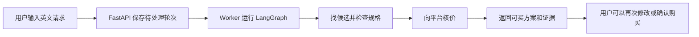
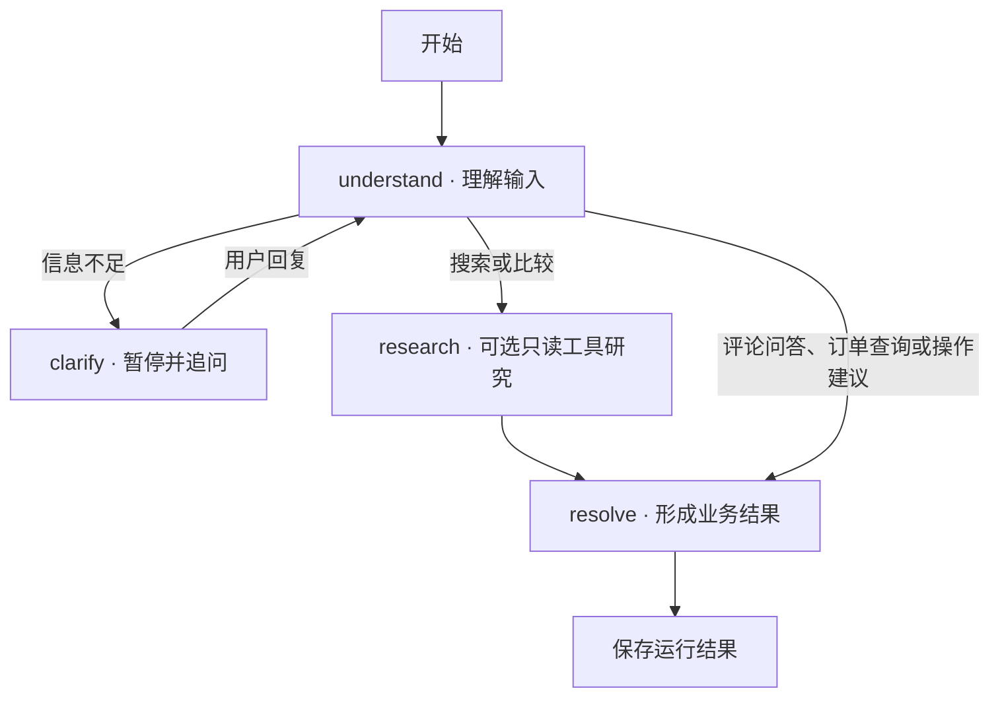

# 从一次购物请求读懂 Shopping Agent V2

这篇指南适合知道 Python、LLM 和向量检索的基本概念，想看清它们怎样在一个项目里配合的读者。阅读顺序跟用户的操作一致。先发出请求，看到推荐，修改方案，再理解确认下单和后台提醒。需要完整接口与逐文件清单时，可以查 [项目详解](PROJECT_GUIDE_ZH.md)。

## 阅读路线

1. [先体验一次购物](#1-先体验一次购物)
2. [理解商品规格与报价](#2-理解商品规格与报价)
3. [从网页请求到后台作业](#3-从网页请求到后台作业)
4. [LangGraph 和模型各自做什么](#4-langgraph-和模型各自做什么)
5. [商品是怎样搜出来的](#5-商品是怎样搜出来的)
6. [怎样选出可买的组合](#6-怎样选出可买的组合)
7. [RAG 怎样使用评论](#7-rag-怎样使用评论)
8. [MCP 怎样连接电商平台](#8-mcp-怎样连接电商平台)
9. [下单和退货为什么分步骤](#9-下单和退货为什么分步骤)
10. [数据库和 Redis 分别存什么](#10-数据库和-redis-分别存什么)
11. [价格提醒怎样自动执行](#11-价格提醒怎样自动执行)
12. [动手练习和读代码路线](#12-动手练习和读代码路线)

## 1. 先体验一次购物

打开 [本机演示页](http://127.0.0.1:8000/)。若项目尚未启动，可以在项目根目录用已有的 Python 环境运行以下命令。本机模式会使用演示目录、内置 Worker 和 SQLite，适合先走一遍流程。安装命令和 Compose 启动方式见 [README](README.md#run-on-windows)。

```powershell
.\.venv\Scripts\python.exe -m shopping_agent api
```

在 Alex 演示账号里输入这句英文。下面的商品和价格来自项目的合成数据。

> Find a lightweight laptop and a dock that can drive a 4K 60 Hz monitor, under $1,000 total.

可能出现两台不同的笔记本和几个扩展坞。有些方案有更轻的电脑，有些更便宜。方案卡会显示对应规格、卖家、总价和预计到货时间，还可以展开推荐理由的证据。此时后端已经请平台核过价。若用户要购买，还会再走一次报价确认。

接着输入第二句话，使用页面上实际显示的方案编号。

> Option 2, keep the laptop and replace the dock with a lighter dock.

这一轮需要三种信息。用户刚说了改哪个部件，上一轮记录了第二套的商品和卖家，任务还记得整套 $1,000 的预算与 60 Hz 要求。后端合并这些信息后，重新找扩展坞并核价。项目有测试验证这条路径。 [英文组合测试](tests/test_workflows.py#L75)



这里的 **Agent** 指负责理解和推进购物任务的整个应用。图中每一步都能在代码里找到对应职责。网页、模型、商品搜索和交易服务分别解决其中一部分。

## 2. 理解商品规格与报价

先看项目里真正存在的一组演示数据。假设你搜索 `Aurora Air 14`，会看到同一系列下的几个规格，同一个规格也可能有多个卖家。

| 层级 | 项目中的例子 | 它回答的问题 |
|---|---|---|
| 商品组 `Product` | Aurora Air 14，ID 为 `air` | 用户说的系列是什么 |
| 具体规格 `SKU` | `air-16` 是银色 16 GB 款，`air-8` 是蓝色 8 GB 款 | 这个版本的内存和接口能力是什么 |
| 销售条目 `Offer` | `air-16-official` 与 `air-16-partner` 都出售 `air-16` | 从谁买，目前卖多少钱，有多少库存 |
| 购买行 `Line` | `{"offer_id":"air-16-official","quantity":1}` | 用户选了哪个卖家的条目，要买几件 |
| 结算报价 `Quote` | 平台针对账户、地址和购买行生成一份有期限的报价 | 这笔交易当前的总价、费用和到货条件是什么 |

为什么要做这种区分？演示里的 `air-16` 在目录中有 `dp_alt: 14`，表示这款支持此处所需的 DisplayPort Alt Mode 级别。`air-8` 的视频能力字段为空。两个标题都叫 Aurora Air 14，用系列名称回答兼容性会混淆这两个版本。再看卖家，演示初始价格里 Aurora 官方是 $719，第三方是 $699。电脑还是同一个 SKU，成交条件可以不同。 [演示商品和销售条目](shopping_agent/seed.py)

代码中的 `71900` 表示 71,900 美分，也就是 $719.00。整数金额便于做加总、价格比较和精确确认。做示例里的整套预算计算时，`air-16-official` 加上初始价 $49 的 `link-mini-official`，合计是 $768。这个数用于解释演示数据。真实调用会向平台取当下的整套报价。 [金额处理和输入类型](shopping_agent/core.py)

## 3. 从网页请求到后台作业

### FastAPI 和 Pydantic 分别解决什么

浏览器里的输入框最终会发 HTTP 请求。HTTP 接口可以理解成约定好的调用地址，每个地址接收固定的数据，并返回可读的结果。先看三个常用接口。

- `POST /v1/tasks` 创建一个购物任务。
- `POST /v1/tasks/{task_id}/turns` 在指定任务里添加一轮用户输入。
- `GET /v1/runs/{run_id}` 查看这一轮现在做到哪一步。

FastAPI 把请求交给相应的 Python 函数。Pydantic 检查请求正文的字段和类型。例如一轮输入要求文本处于允许的长度，时区能解析为 IANA 时区。购物行的 `quantity` 必须是 1 到 20 之间的整数。请求到达业务函数时，函数已经能按对应的数据结构读取字段。网页 `demo.html`、Swagger 和你自己写的客户端都可以调用同一组接口。 [请求模型与接口实现](shopping_agent/api.py)

### 为什么发完消息先收到一个 ID

一条请求可能需要查目录、调用模型、等待平台报价。API 把待处理工作存入数据库后，先返回 `202 Accepted` 和 `run_id`。**Worker** 领取这轮请求，运行 LangGraph，再把状态和结果写回去。浏览器通过 SSE 接收检索进度，随后逐条显示通过引用校验的推荐理由。断线时可按事件编号续接，也可以按 `run_id` 轮询最终结果。 [轮次 API](shopping_agent/api.py#L207) · [Worker 实现](shopping_agent/runtime.py)

| 标识 | 保存了什么 | 什么情况下有用 |
|---|---|---|
| `task_id` | 一次持续的购物目标，可以包含多轮对话 | “把扩展坞换轻一点”要沿用原目标 |
| `run_id` | 某一轮操作及其状态，如 `queued`、`running`、`needs_input`、`completed`、`failed` | 网页刷新后可以继续查这一轮的结果 |
| `plan_version` | 用户引用的那批方案来自任务的哪个历史版本 | 页面看到的是上一批结果，用户仍想选当时的第二套 |
| `expected_version` | 客户端提交这轮改动时预期任务在哪个版本 | 两个页面同时编辑时，发现自己手里的版本已经过时 |

举个并发例子。两个页面都读到版本 1。一个页面把预算改成 $900 并成功写入版本 2，另一个页面还想以版本 1 为基础修改扩展坞。后端可以报告 `task_conflict`，让客户端读最新状态。即使两个请求在版本 1 时都被接收，Worker 写回结果时也会再检查版本。这个机制叫**乐观并发控制**，意思是允许工作先进行，在写回时检查期间有没有别人改过。历史版本另外保存，所以“引用旧方案”仍然有明确的对象。 [轮次保存和版本检查](shopping_agent/runtime.py#L35)

## 4. LangGraph 和模型各自做什么

### 先把英文句子变成 Python 能处理的字段

如果一句话只作为字符串保存在聊天记录里，后端要检查预算或兼容性时，还得从整句话里重新理解。项目把句子解析成 `Patch`，即**这一轮对购物目标提出的改动**，然后合并到已有的 `goal`。以下是第一轮请求的核心含义，省略了代码中的其他字段。

```json
{
  "action": "search",
  "categories": ["dock", "laptop"],
  "budget": 100000,
  "light": true,
  "hz": 60
}
```

代码先用 `detect()` 处理常见英文表达。如果配置了 LLM，再让模型按 `Patch` 对应的 JSON schema 组织回复。**Prompt Engineering** 在这里具体表现为给模型明确任务、结构和示例规则。系统提示要求模型提取显式的变化、使用美元分、理解预算约束整套方案，并识别 “a dock that can drive a monitor” 里的显示器只是连接目标。`models.py` 调用兼容的 `/chat/completions` 接口，`graph.py` 用 Pydantic 校验返回字段。模型返回无效结构时，内置规则仍然能覆盖演示问法。 [意图模型与提示词](shopping_agent/graph.py#L240) · [模型 HTTP 客户端](shopping_agent/models.py#L44)

颜色、尺码和材质等商品属性可以写成 `conditions`。每项都带品类、属性名、比较方式、目标值和是否必选。例如“蓝色棉衬衫搭配黑色帆布包”会把两组颜色和材质分别归到对应品类。不同品类共用等值、范围和集合筛选，具体可用属性由目录定义。 [属性定义](shopping_agent/attributes.json) · [条件解析](shopping_agent/attributes.py#L115)

### LangGraph 把处理步骤写在程序里

`StateGraph` 把一次运行定义为几个函数及其转移关系。**状态**是这些函数之间传递的数据，比如原始请求、当前目标、上一批方案、证据和最终结果。程序决定接下来执行哪个节点。



试着把第一次请求改成 “Find a dock that can drive a 4K 60 Hz monitor.”。这次你只买扩展坞，系统缺少要连接哪类主机的信息。`clarify()` 可以问主机的视频协议并暂停。系统用 **checkpoint** 保存执行状态，收到 “My laptop supports DisplayPort 1.4 Alt Mode.” 后，按同一个 `run_id` 恢复。回复里的笔记本提供已有设备的信息，购买品类仍是扩展坞。测试会关闭第一次创建的应用，再启动另一个应用，验证它能从保存的位置继续。 [LangGraph 节点和路径](shopping_agent/graph.py#L226) · [澄清恢复测试](tests/test_workflows.py#L102)

LangChain 常用来统一封装模型、消息和工具。LangGraph 负责定义步骤、分支和可恢复的状态流程。在这个项目的代码里，`graph.py` 用 LangGraph 编排步骤，`models.py` 用 HTTP 调模型，`runtime.py` 把执行和持久化接到 Worker 上。

### Function Calling 是谁调用谁

在研究节点中，程序可以向模型声明 `search_products` 和 `get_product_evidence`。声明里包含工具名、用途和参数 schema。下面用项目的品类和查询结构举例，简化了模型供应商返回的外层字段。

```json
{
  "name": "search_products",
  "arguments": {
    "category": "dock",
    "query": "compact 4K HDMI dock"
  }
}
```

这段 JSON 是模型提出的请求。Python 会核对工具名、参数、品类范围，再执行检索，把结果交还给模型。评论工具只能查本轮工具研究中已见过的商品组。多品类搜索最多进行两轮工具研究，每轮最多处理三个调用。单品类搜索在候选不足时可以补查一轮。若模型返回 `commerce_submit`，程序会把它作为不可用工具处理。每次工具调用是否成功可在 `trace.tools` 里观察。 [研究节点与工具白名单](shopping_agent/graph.py#L355)

## 5. 商品是怎样搜出来的

对于笔记本和扩展坞这个请求，后端按购买品类分别搜。这样可以从电脑候选中取一台，再从扩展坞候选中取一个。`Catalog.hybrid()` 会组织下面两路文本检索。

| 路径 | 初学者可以先这样理解 | 本项目中的例子 |
|---|---|---|
| BM25 关键词召回 | 根据查询词与文档的匹配程度排序，并考虑哪些词更有区分度 | `USB-C`、`HDMI`、`4K@60Hz` 或具体型号命中时容易找到相应条目 |
| 文本向量召回 | embedding 把文字转换为数字数组，用向量相似度检索表达相近的文档 | 搜 `lightweight laptop for commuting` 时，描述写的是 `portable business laptop` 也有机会成为候选 |

**向量和向量索引是两件不同的事。** embedding 决定文档怎样表示成数字，HNSW 索引帮助 Elasticsearch 快速找接近查询向量的候选。当前 Compose 把向量存入 Elasticsearch 的 `dense_vector` 字段，由 Elasticsearch 同时执行关键词和向量检索。默认的向量由项目的 128 维演示算法生成，按英文 token 做哈希，便于稳定复现。配置外部 `EMBEDDING_MODEL` 并用相同模型重建索引后，才会使用该模型的语义向量。无 Elasticsearch 的本机模式由 Python 在小目录上执行关键词与向量检索。 [检索实现和索引配置](shopping_agent/catalog.py) · [向量生成方式](shopping_agent/models.py#L128)

### 各路结果怎样合并

两路评分的含义不同。项目用 **RRF** 合并它们的名次。假设关键词路把 Link Mini 排第 1，向量路把它排第 3，它得到 `1/(60+1) + 1/(60+3)`。如果 Link Nano 只出现在向量路第 1 名，它在这个示例中的得分是 `1/(60+1)`。两路都找到的商品因此能获得更高的融合分。商品目录按记录 ID 合并片段，评论召回按商品组计分。各路排名也会记录到检索轨迹中。

**召回**把大目录缩成一个候选集合。涉及舒适度或上脚感受时，评论片段也可以把相关商品带进候选池。购买方案用属性配置在同一 SKU 上检查必选条件，再把通过的候选送去**精排**。例如同款鞋有黑色 7 码和白色 8 码时，还需要找到一个同时满足黑色和 8 码的 SKU。Compose 中配置 CLIP 并为本地商品图片建索引后，单品类搜索还可以根据参考图或外观描述召回相关图片。配置视觉模型后，也可以对少量有图片的候选做带图精排。 [检索和精排入口](shopping_agent/catalog.py#L233) · [属性定义](shopping_agent/attributes.json)

## 6. 怎样选出可买的组合

搜索返回的是“值得进一步检查的商品”。Planner 接下来要回答的是“这两个具体规格搭配起来，能从当前卖家买到吗？”看看下面四组用演示种子计算的例子。

| 组合 | 初始条目价格 | 检查结果 |
|---|---:|---|
| `air-16-official` + `link-mini-official` | $719 + $49 = $768 | 主机协议和 HDMI 4K 60 Hz 都满足，价格低于 $1,000 |
| `air-16-official` + `link-lite-official` | $719 + $29 = $748 | 这个扩展坞只提供 4K 30 Hz，组合被淘汰 |
| `air-8-official` + `link-mini-official` | $619 + $49 = $668 | 这款笔记本没有已验证的所需视频输出，组合被淘汰 |
| `summit-32-official` + `link-mini-official` | $1,059 + $49 = $1,108 | 规格可以配合，若核价仍为 $1,108，则超出总预算 |

代码先为每个品类建候选列表，然后批量查这些 SKU 的 Offer。`compatibility()` 检查主机能提供的协议、扩展坞需要的输入，以及它在目标端口能输出的刷新率。显式要求 DisplayPort 输出时，只有 HDMI 的 Link Mini 会被排除。像 `air-8` 这样的规格缺失案例也有明确结论，即当前证据不足以确认它满足要求。

得到通过规格检查的组合后，Planner 用粗估价格选择要核价的组合。平台报价返回后，先验证整套预算和送达截止时间，再按用户偏好排序。比如“最便宜”按实际应付，“最快送达”按实际预计到货时间。最终按 SKU 组合去重，最多返回三套。 [单品规格过滤](shopping_agent/planner.py#L31) · [候选组合与报价](shopping_agent/planner.py#L199)

第二轮说“保留笔记本，换轻一点的扩展坞”时，程序固定已选的笔记本 SKU 和卖家 Offer，排除原扩展坞。原扩展坞有已知重量时，新的一轮会要求替代件比它更轻。以示例里的 Link Mini 为例，重量为 82 g，Link Nano 的 58 g 可满足变轻要求。Link Lite 虽然只有 50 g，仍会因 30 Hz 规格被淘汰。这是“保留一个约束的同时改变另一个条件”的具体实现。 [修改方案的处理](shopping_agent/graph.py#L416) · [重量与规格数据](shopping_agent/seed.py)

## 7. RAG 怎样使用评论

**RAG** 在这里指先找到和问题相关的证据，再把证据交给回答逻辑。对本项目来说，一次检索可以服务于两类不同任务。

| 检索目的 | 查什么 | 结果怎么用 |
|---|---|---|
| 先找商品 | 商品名、描述、规格等目录字段，以及与体验要求相关的评论片段 | 得到参与组合与报价的候选 |
| 再找证据 | 候选商品组内的相关评论，能对上变体时优先找对应变体 | 给用户展示体验类原文与来源 |

例如，用户想知道扩展坞是否便于携带。项目里的 Link Mini 评论写道：

> Fits into my laptop bag. The included cable is short.

模型可以挑选其中一句作为体验摘录。短评论整条入索引，长评论按句子或段落附近的边界切分。每个片段保留原文记录 ID，方便检索后核对出处。用户说“我要 4K 60 Hz”时，程序用结构化规格判断。用户想知道今天的总价时，程序用平台报价。 [评论分块](shopping_agent/passages.py#L31) · [演示评论](shopping_agent/seed.py#L58)

配置外部模型时，程序会把问题、最多三个候选及各自的证据交给模型。模型逐条生成理由、取舍和引用。程序核对每条引用是否属于对应候选、摘录是否出现在原文中，再通过 SSE 发给页面。未配置模型时，演示用已有资料生成简短理由。单独追问某款鞋是否偏小，程序会先定位商品，再查评论，并保留上一轮的购买方案。 [推荐生成与引用校验](shopping_agent/recommendations.py#L94) · [评论问答](shopping_agent/graph.py#L529)

### Reviews’23 数据怎样进入项目

可以把 Reviews’23 理解成一批已有的商品资料和评论。导入代码读取 `dataset/` 中的元数据和评论文件，按 `parent_asin` 关联商品组。评论自己的 `asin` 保留到 `external_asin`，便于追踪变体。在 Compose 中，导入先写平台 PostgreSQL，再由 `reindex` 建立 Elasticsearch 索引。后续购物请求用索引找候选，再从平台目录读取原始记录。

README 的固定样本会导入 23 件 Amazon Fashion 商品，可以选择同时加载四个模拟 SKU 的价格与库存。商品卡可能显示抓取时的价格快照，具体购买方案需要平台给对应 SKU 返回当前报价。有了样本和模拟报价，就可以试 “Find black shoes in US size 8 under $60.”，再追问 Bandolino 鞋款是否偏小。 [导入实现](shopping_agent/dataset.py) · [项目的数据导入命令](README.md#import-amazon-reviews23)

## 8. MCP 怎样连接电商平台

项目中可以看到三种调用关系。它们看起来都像“发请求再收结果”，把调用方和被调用方写出来就容易区分。

| 调用关系 | 具体例子 | 调用方为什么要发这个请求 |
|---|---|---|
| 浏览器 → Agent API | `POST /v1/tasks/{task_id}/turns` | 把用户输入交给 Agent |
| Agent → 模型 API | `POST /chat/completions` | 请模型提取意图、提出只读工具调用或生成推荐理由 |
| Agent → 电商平台 | `commerce_quote` | 请拥有库存和报价的业务系统核价 |

**MCP** 为第三种调用提供一种约定好的工具接口。在 Compose 模式，Agent 是 MCP 客户端，平台 sandbox 是 MCP 服务端。sandbox 是用来复现正常交易、涨价或付款失败的模拟业务系统。下面这个函数调用展示了 Agent 内部传给平台的参数。

```python
quote = platform.call(
    "commerce_quote",
    {
        "account_id": "alex",
        "address_id": "home",
        "lines": [{"offer_id": "link-mini-official", "quantity": 1}],
    },
)
```

本机默认运行时，`platform` 是同进程的 `MockPlatform`，Python 直接运行核价方法。配置远程平台后，`RemotePlatform` 用 HTTP 工具路由或 MCP 的 `call_tool()` 发送相同的业务参数。Compose 配置选择后者，客户端连接平台的 `/mcp`。平台接到请求后校验参数、访问平台数据库，再把报价结果返回。业务函数始终能调用同一个 `platform.call()`，因此可以在本机轻量模式和远程服务模式间切换。 [平台工具与适配器](shopping_agent/platform.py) · [Compose 中的平台连接](compose.yaml)

当你读到 **Function Calling**，问“这条工具请求是不是由模型提出的”。当你读到 **MCP**，问“Agent 用什么协议调用远程工具”。在这个项目里，`search_products` 和 `get_product_evidence` 由 Agent 直接查目录。平台另外注册了 12 个交易工具，例如 `commerce_offers` 查报价条目和库存，`commerce_quote` 核价并计算预计到货时间。手动结账确认后，结算 Worker 经 MCP 调用 `commerce_submit`。 [平台工具列表](shopping_agent/platform.py#L168) · [研究节点](shopping_agent/graph.py#L355)

## 9. 下单和退货为什么分步骤

### 从“想买第二套”到一笔订单

用户说 “Buy option 2.” 时，LangGraph 可以返回操作建议。演示页的 `Add to cart` 按钮用于直接加购。要提交订单，可以在方案卡上点击 `Review checkout`，查看正式条款后再确认。

1. **发起报价。** `POST /v1/quotes` 传历史方案、某个购物车版本，或一组明确 Offer。Agent 找出所选行，向平台获取当前报价。
2. **保存待确认条款。** Agent 给这份报价保存一条收据。返回值里的 `terms` 是从报价内容计算出来的指纹。客户端展示金额、商品、地址、到货时间与期限。
3. **确认收据。** 客户端把 `receipt_id` 和原样的 `terms` 交回来。服务端核对账户、报价、期限和当前收据上保存的约束，随后创建一个固定的 `attempt_id`。API 此时返回 `202`。
4. **后台执行。** Worker 领取结算作业，先用 `attempt_id` 调 `commerce_status`。平台没有这笔尝试的结果时，再以同一个 ID 提交。
5. **查询结果。** 客户端查询 `GET /v1/checkouts/{attempt_id}`。常见状态是 `processing`、`succeeded`、`failed` 和 `requote`。出现 `requote` 时，会拿到新的收据供用户审核确认。

如果 $49 的扩展坞涨到了 $55，原来展示的金额就发生了变化。平台重新给价，Agent 保存新条款，用户再次确认。这个场景解释了为什么项目在推荐时查一次价，到实际结算又要检查一次。 [结算实现](shopping_agent/checkout.py) · [报价变化测试](tests/test_workflows.py#L152)

### 最值得读懂的故障例子

设想用户点了确认，平台已经记录订单和付款，返回状态的网络请求却断了。此时浏览器只知道“还在处理中”。如果收到超时就换个新 ID 再下单，会有产生第二笔交易的风险。本项目恢复依次经历三步。

1. Agent 记录原有 `attempt_id`，把状态留在 `processing`。
2. Worker 等一小段时间后，用同一个 ID 查询。
3. 平台找到了已经保存的订单结果。Agent 把原有尝试更新为 `succeeded`。

**幂等**在这里的具体含义是，同一个操作 ID 重试，可以读回已有业务结果。**事务**则用来把一组相关数据库写入一起提交。平台在模拟购买成功时一起记录库存变化、订单、支付流水和操作结果。两者一起使这个失败场景可恢复。测试会模拟多次并发确认、丢失响应和重启，并检查只看到一笔支付和订单。 [平台提交实现](shopping_agent/platform.py#L290) · [断线恢复测试](tests/test_workflows.py#L170)

### 订单分包与退货

项目按卖家分包。一笔订单里，笔记本可能已送达，扩展坞仍在运输中。退货预览按具体购买行检查该行所在包裹是否送达、剩余可退数量和演示退货窗口，再给出预计退款。用户确认预览后，系统生成退货申请。这样用户可以先退已送达的行，同时保留另一件商品的物流状态。 [分包与退货实现](shopping_agent/platform.py#L343) · [分包退货测试](tests/test_workflows.py#L194)

## 10. 数据库和 Redis 分别存什么

做教学项目时，把上一轮方案保存在 Python 变量里很方便。这里把重要状态存入数据库，用户刷新页面、网络中断或 Worker 重启时，应用还有记录可查。Compose 用 PostgreSQL，本机模式把同类记录存在 SQLite 文件里。

### 购物任务、运行记录和 checkpoint

以刚才的扩展坞澄清为例，有三种不同的持久化数据。

| 保存的东西 | 例子 | 读它的时机 |
|---|---|---|
| 购物任务和历史方案 | “预算 $1,000”“版本 1 的第二套含哪些 Offer” | 开始下一轮或点击旧方案时 |
| 轮次运行记录 | “这一轮现在是 `needs_input`，等待回复某个问题” | 浏览器查进度，后台 Worker 领取作业时 |
| LangGraph checkpoint | “图执行到澄清节点，已有这些节点状态” | 用户回复后，图从已保存位置继续时 |

项目用一张 `shopping_records` 表收纳不同类型的业务记录，`bucket` 标明是任务、报价还是通知等。每条记录有自己的 `key`、可选的执行期限和 JSON 内容。例如，购物任务在 `tasks`，历史方案在 `task_views`，待处理轮次在 `runs`。checkpoint 则由 LangGraph 的存储组件管理。在 Compose 中，Agent 数据库保存任务和运行状态，平台数据库保存导入的商品与评论，以及 Offer、购物车和订单等交易记录。 [数据表与事务](shopping_agent/storage.py) · [运行记录和 checkpoint 接入](shopping_agent/runtime.py)

Worker 领取作业时会给这项工作标记一个临时有效的**租约**。你可以把它读成“这个 Worker 在期限内负责这条记录”。写回结果时再核对租约。若它崩溃，期限过后，其他 Worker 可以重新领取。处理下单时还会复用业务操作 ID，所以作业重试与订单去重可以一起工作。 [领取作业](shopping_agent/runtime.py#L260) · [写回结果](shopping_agent/runtime.py#L124)

### Redis 的两项工作

1. **限流。** 配置 Redis 后，API 对每个账户在 60 秒的计数窗口里限制轮次提交次数。比如超过当前设定的 35 次时，收到 `429`。共享的计数让多个 API 实例可以看到同一账户的请求次数。
2. **短期缓存。** 使用外部 embedding 服务时，最近生成的部分向量可以在 Redis 留 10 分钟。同一模型、端点和文本再次出现时，可以少做一次远程请求。

订单结果和购物任务从持久化数据库读取。Redis 主要帮接口共享短期计数和减少重复计算。Elasticsearch 则帮助按关键词和相似度查商品。 [轮次限流](shopping_agent/api.py#L206) · [Embedding 缓存](shopping_agent/models.py#L128)

### 为什么仓库里有 Docker Compose

学流程时，可以用 Python 直接运行。想观察 API、Worker、平台和数据服务作为独立进程交互时，可以用 Compose。启动时 `indexer` 从目录库生成 Elasticsearch 索引，成功后退出。然后 API 接收请求，独立的 Worker 从数据库领取任务。改过代码后用 `docker compose up --build -d` 重建应用镜像。用 `docker compose stop` 停止服务时，数据库和索引的数据卷会保留。 [运行模式与启动步骤](README.md#run-the-service-stack)

## 11. 价格提醒怎样自动执行

通过方案卡的 `Track price` 可以设置提醒。下面用一个更容易核对的单品例子。假设规则明确关注 `link-mini-official`，希望整单总价降到 $40 或以下。它的演示初始价格是 $49。若平台把价格改为 $39，过程如下。

1. 创建时，Agent 保存账户、具体 Offer、数量、地址、价格阈值和有效期。
2. 平台在修改价格的数据库事务里，顺便记录一条待发送的 Offer 事件。
3. Agent 收到事件后，用事件 ID 检查是否已处理，并唤醒对应规则。定期检查也可以在没有收到事件时继续尝试核价。
4. Worker 用当前平台报价判断是否达到 $40。满足条件时写入站内通知和这一次的执行记录。

自动化 API 还支持 `cart` 或 `buy`。前者只在条件满足时加购物车。后者需要额外启用，并由用户预先授权单次上限、累计预算和已保存的付款方式。基于保存搜索的规则如果要执行加购或购买，还要提供允许的 SKU 和卖家。`buy` 触发后由结算 Worker 执行。规则可以撤销，后台会在接受执行前复查状态与版本。 [提醒和自动采购实现](shopping_agent/automation.py) · [降价触发与撤销测试](tests/test_workflows.py#L218)

## 12. 动手练习和读代码路线

### 练习一 · 用 Swagger 看到网页背后的请求

打开 [本机 API 文档](http://127.0.0.1:8000/docs)，点击 `Authorize`，填入演示 token `demo-alex`。

1. 在 `POST /v1/tasks` 点击 `Try it out` 并执行，记下返回的 `id`。
2. 在 `POST /v1/tasks/{task_id}/turns` 填入这个 ID，提交下面的 JSON。
3. 从返回结果复制轮次的 `id`，用 `GET /v1/runs/{run_id}` 查看。若仍在运行，过一会儿再查。完成后展开 `result.plans`，对照其中一个方案的 `items`、`quote.total` 和 `evidence`。推荐理由和引用在 `result.recommendations`。把金额除以 100 再和页面比较。

```json
{
  "text": "Find a lightweight laptop and a dock that can drive a 4K 60 Hz monitor, under $1,000 total.",
  "expected_version": 0,
  "request_id": "practice-1"
}
```

还可以在 `result.trace.search` 分别找 `dock` 和 `laptop` 的排名。没配置 Chat 模型时，`trace.tools` 为空是正常的，确定性搜索和核价仍能运行。 [API 对应实现](shopping_agent/api.py#L206)

### 练习二 · 在一条测试里看清楚“收到退款预览”和“实际执行”的分界

先读 `test_cart_revision_idempotency_and_split_return`。它先发两次同样的加购操作，再用旧版本发一个不同操作，接着购买一组跨卖家的商品。你可以在读到退货请求前先预测，哪个包裹允许申请退货，以及为什么重发确认会返回相同的 ID。然后对照断言。 [分包退货测试](tests/test_workflows.py#L194)

### 练习三 · 用测试学会追踪一次故障

先阅读购买断线恢复测试，找出它在哪一行注入 `lost_response`，在哪一行查询原有的购买尝试。然后运行下面这一条测试。它使用临时演示数据库和可控时钟。测试在重启后检查状态、订单数与支付流水数。 [购买断线恢复测试](tests/test_workflows.py#L170)

```powershell
.\.venv\Scripts\python.exe -m pytest -q tests/test_workflows.py::test_unknown_payment_recovers_once_and_orders_are_isolated
```

### 练习四 · 用标注场景评估购物和检索

```powershell
.\.venv\Scripts\python.exe -m shopping_agent evaluate-journeys
.\.venv\Scripts\python.exe -m shopping_agent evaluate --k 3
```

第一条命令在临时数据库回放 109 个英文购物场景，共 131 轮。场景用模拟目录和报价检查硬条件、首选方案、正确的评论证据和多轮条件保留。报告里的 p95 来自本机轮次回放。可以在 `results` 中找到每轮耗时和失败的断言。

第二条命令单独测检索。Recall@3 看前三名找回了多少相关商品，MRR 看第一个相关结果出现在多前面，NDCG@3 还考虑相关性等级。即使两次检索找回了同样的商品，把更符合需求的商品排前面，NDCG 通常会更高。默认用例同时包含二元标注和 0–3 级标注。真实 Amazon Fashion 样本的导入和评估命令见 README。 [购物场景](fixtures/shopping_journeys.jsonl) · [检索标注](fixtures/search_cases.jsonl) · [Amazon Fashion 评估](README.md#import-amazon-reviews23)

### 按你想追踪的问题打开文件

| 你想弄明白的问题 | 第一个文件 | 下一站 |
|---|---|---|
| Python 服务怎样从命令启动，网页从哪里来 | [__main__.py](shopping_agent/__main__.py) | CLI 用 Uvicorn 监听 HTTP，FastAPI 在 [api.py](shopping_agent/api.py) 声明接口并提供 [demo.html](shopping_agent/demo.html) |
| “搜扩展坞”怎样变成一轮查询 | [api.py](shopping_agent/api.py#L206) | [runtime.py](shopping_agent/runtime.py#L35) → [graph.py](shopping_agent/graph.py#L240) |
| 为什么某个商品出现在候选里，却没出现在可买方案里 | [catalog.py](shopping_agent/catalog.py#L233) | [planner.py](shopping_agent/planner.py#L31) |
| 模型请求查评论时，谁真正执行工具 | [graph.py](shopping_agent/graph.py#L355) | [models.py](shopping_agent/models.py#L44) → [catalog.py](shopping_agent/catalog.py#L307) |
| 推荐理由怎样带着可核对的引用送到网页 | [recommendations.py](shopping_agent/recommendations.py#L94) | [runtime.py](shopping_agent/runtime.py#L86) → [api.py](shopping_agent/api.py#L230) |
| 按下确认按钮后，怎样防止重复下单 | [checkout.py](shopping_agent/checkout.py#L45) | [platform.py](shopping_agent/platform.py#L290) |
| 如何在没有网页的情况下证明业务规则有效 | [test_workflows.py](tests/test_workflows.py) | 顺着测试调用的 API 和 Worker 找对应实现 |

第一次读代码，建议把这一行当作起点。找到 `POST /v1/tasks/{task_id}/turns`，依次追踪“谁保存输入”“谁执行这一轮”“谁返回最后结果”。等能在三个文件里找到这些位置，再把模型、数据库和平台调用加到自己的阅读路径中。
